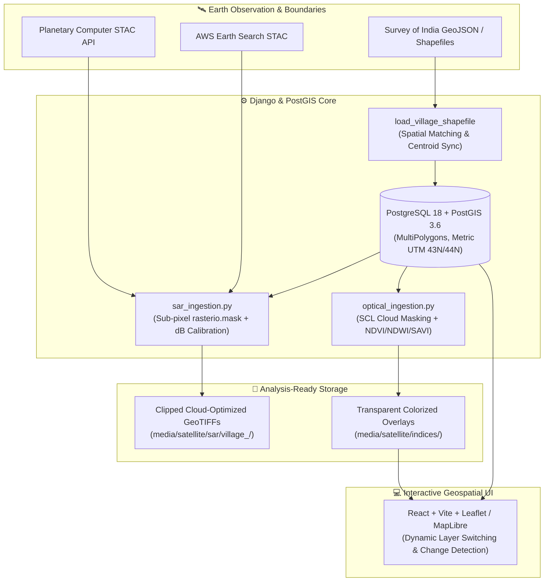

# Smart Village Monitoring System 🛰️🌾
> **AI-Powered Earth Observation & Geospatial Platform for Rural Development & Climate Resilience**

[](https://www.python.org/)
[](https://www.djangoproject.com/)
[](https://postgis.net/)
[](https://sentinels.copernicus.eu/web/sentinel/missions/sentinel-1)
[](https://sentinels.copernicus.eu/web/sentinel/missions/sentinel-2)
[](LICENSE)

An enterprise-grade, end-to-end geospatial monitoring platform combining **Sentinel-2 Multi-Spectral Optical imagery**, **Sentinel-1 Dual-Pol Synthetic Aperture Radar (SAR)**, and official **Survey of India administrative village boundaries**. The platform provides automated biomass, water body, and infrastructure change detection across rural India, unaffected by cloud cover or seasonal weather barriers.

---

## 📑 Table of Contents
- [System Architecture](#-system-architecture)
- [Key Capabilities & Phases](#-key-capabilities--phases)
  - [Phase 1: Multi-State Geographic Foundation](#phase-1-multi-state-geographic-foundation)
  - [Phase 2: Sentinel-1 SAR Acquisition & Processing](#phase-2-sentinel-1-sar-acquisition--processing)
  - [Phase 3: Optical Multi-Spectral Analysis](#phase-3-optical-multi-spectral-analysis)
- [Pilot Villages Database](#-pilot-villages-database)
- [Installation & Setup](#-installation--setup)
- [Management Commands & CLI](#-management-commands--cli)
- [Mathematical & Radar Formulations](#-mathematical--radar-formulations)
- [Testing & Quality Assurance](#-testing--quality-assurance)

---

## 🏗️ System Architecture



---

## 🚀 Key Capabilities & Phases

### Phase 1: Multi-State Geographic Foundation
- **Official Cadastral Boundaries**: Direct ingestion of high-resolution Survey of India village boundaries (`MultiPolygonField`).
- **Dynamic Metric UTM Projections**: Eliminates latitude-dependent spherical distortions by automatically projecting to appropriate UTM zones:
  - **UTM Zone 43N (`EPSG:32643`)**: Western India / Rajasthan.
  - **UTM Zone 44N (`EPSG:32644`)**: Central & Northern India / Uttar Pradesh.
- **Centroid & Marker Pin Synchronization**: Guarantees zero offset (`0.00 km`) between database coordinates and boundary geometric centroids.
- **Bulk CSV Seeding Engine**: `seed_bulk_villages` command with header normalization, coordinate fallbacks, and automatic district centroid resolution.

### Phase 2: Sentinel-1 SAR Acquisition & Processing
Cloud-penetrating, day/night radar pipeline designed to maintain continuous monitoring during monsoon seasons and cloudy conditions:
- **STAC Asset Querying**: Searches `sentinel-1-rtc` (Radiometrically Terrain Corrected) and `sentinel-1-grd` IW (Interferometric Wide Swath) products.
- **Sub-Pixel Boundary Clipping**: Direct streaming and clipping using `rasterio.mask` against official PostGIS MultiPolygon geometries.
- **Radiometric Calibration**: Converts raw digital numbers (DN) to backscatter coefficient $\sigma^0$ in Decibels (dB).
- **Dual-Pol Cross-Ratio ($VH_{\text{dB}} - VV_{\text{dB}}$)**: Measures vegetation structure, canopy roughness, and biomass density.
- **Radar Vegetation Index (RVI)**: Dual-pol formulation estimating vegetation water content and cover.
- **Automated Database Indexing**: Registers bands and index products into `SatelliteScene`, `SatelliteBand`, and `SpectralIndex` with automated statistical summaries (mean, median, standard deviation, valid pixel count).

### Phase 3: Optical Multi-Spectral Analysis (Sentinel-2 Level-2A)
- **NDVI** (Normalized Difference Vegetation Index): Crop health and canopy greenness.
- **NDWI** (Normalized Difference Water Index - McFeeters): Surface water bodies and pond tracking.
- **SAVI** (Soil-Adjusted Vegetation Index): Vegetation in arid and semi-arid soils ($L=0.5$).
- **MNDWI** (Modified NDWI): Urban and turbid water discrimination.
- **SCL Cloud Masking**: Bitmask filtering using Sentinel-2 Scene Classification Layer.

### Phase 4: Copernicus DEM (GLO-30) & Topographic Terrain Stack
Preparation of 30m elevation and topographic features for multi-modal U-Net segmentation:
- **STAC Asset Querying**: Searches Microsoft Planetary Computer `cop-dem-glo-30` collection intersecting official village PostGIS MultiPolygons with automated SAS token authentication.
- **Boundary Precision Masking**: Clips elevation models directly via `rasterio.mask` with sub-pixel alignment.
- **Topographic Slope Derivation (Horn 1981)**: Computes 3x3 weighted finite-difference terrain slope in degrees ($0^\circ - 90^\circ$) with Euclidean distance padding to eliminate edge nodata cliffs.
- **Sentinel Grid Alignment**: Bilinear reprojection onto the exact UTM coordinate grid, resolution, and affine transform of existing Sentinel-1 / Sentinel-2 rasters for seamless neural network tensor stacking (`[C, H, W]`).

### Phase 5: Ground Truth Labels (ESA WorldCover 10m)
Automated extraction and alignment of categorical land cover ground truth for U-Net semantic segmentation ($y$ target mask):
- **STAC Querying**: Queries `esa-worldcover` 10m Land Use / Land Cover (LULC) dataset from Microsoft Planetary Computer.
- **Nearest-Neighbor Alignment**: Uses `Resampling.nearest` during reprojection to strictly preserve integer categorical class IDs (10: Tree cover, 20: Shrubland, 30: Grassland, 40: Cropland, 50: Built-up, 60: Bare, 80: Water, 90: Wetland).
- **Target Mask Export**: Generates `worldcover_aligned.tif` (uint8, nodata=0) exactly matching the spatial grid and dimensions of the multi-spectral and radar input stack.

---

## 📍 Pilot Villages Database

Currently verified and loaded in PostGIS with official Survey of India boundaries:

| State | District | Village Name | Boundary Geometry | UTM Zone |
| :--- | :--- | :--- | :---: | :---: |
| **Rajasthan** | Rajsamand | **Piplantri** | MultiPolygon | 43N (`EPSG:32643`) |
| **Rajasthan** | Rajsamand | **Kothariya** | MultiPolygon | 43N (`EPSG:32643`) |
| **Rajasthan** | Jhunjhunu | **Mandawa** | MultiPolygon | 43N (`EPSG:32643`) |
| **Rajasthan** | Phalodi | **Bhadla** | MultiPolygon | 43N (`EPSG:32643`) |
| **Rajasthan** | Jaisalmer | **Kuldhara** | MultiPolygon | 43N (`EPSG:32643`) |
| **Uttar Pradesh** | Ghazipur | **Gahmar** | MultiPolygon | 44N (`EPSG:32644`) |
| **Uttar Pradesh** | Etawah | **Saifai** | MultiPolygon | 44N (`EPSG:32644`) |
| **Uttar Pradesh** | Lucknow | **Juggaur** | MultiPolygon | 44N (`EPSG:32644`) |
| **Uttar Pradesh** | Lucknow | **Itaunja** | MultiPolygon | 44N (`EPSG:32644`) |
| **Uttar Pradesh** | Gorakhpur | **Dumri Khas** | MultiPolygon | 44N (`EPSG:32644`) |
| **Uttar Pradesh** | Gorakhpur | **Bhatkaon** | MultiPolygon | 44N (`EPSG:32644`) |
| **Uttar Pradesh** | Deoria | **Chainpur** | MultiPolygon | 44N (`EPSG:32644`) |
| **Uttar Pradesh** | Deoria | **Sonbarsa** | MultiPolygon | 44N (`EPSG:32644`) |
| **Uttar Pradesh** | Etawah | **Atirajpur** | MultiPolygon | 44N (`EPSG:32644`) |
| **Uttar Pradesh** | Etawah | **Baidpura** | MultiPolygon | 44N (`EPSG:32644`) |
| **Uttar Pradesh** | Etawah | **Parasana** | MultiPolygon | 44N (`EPSG:32644`) |
| **Uttar Pradesh** | Etawah | **Phoolpur** | MultiPolygon | 44N (`EPSG:32644`) |
| **Uttar Pradesh** | Etawah | **Tulsipur** | MultiPolygon | 44N (`EPSG:32644`) |
| **Uttar Pradesh** | Etawah | **Ujhiyani** | MultiPolygon | 44N (`EPSG:32644`) |
| **Uttar Pradesh** | Barabanki | **Haswapara** | MultiPolygon | 44N (`EPSG:32644`) |

---

## ⚙️ Installation & Setup

### 1. Prerequisites
- **Python**: 3.12+
- **Node.js**: 18+ and npm
- **Database**: PostgreSQL 16+ with **PostGIS 3.4+** extension enabled
- **GDAL**: Compatible GDAL runtime installed for Rasterio / GeoPandas

### 2. Backend Setup
```bash
# Clone the repository
git clone https://github.com/adarsh0201/smart_village_monitoring_system.git
cd smart_village_monitoring_system

# Create and activate virtual environment
python -m venv backend/venv
# Windows:
.\backend\venv\Scripts\activate
# Linux/macOS:
source backend/venv/bin/activate

# Install dependencies
pip install -r backend/requirements.txt

# Configure environment variables
cp backend/.env.example backend/.env
# Edit backend/.env with your PostgreSQL credentials

# Run database migrations
python backend/manage.py migrate
```

### 3. Frontend Setup
```bash
cd frontend
npm install
npm run dev
```

---

## 🛠️ Management Commands & CLI

### Seed Villages from CSV
```bash
# Dry run preview
python backend/manage.py seed_bulk_villages --file data/sample_villages.csv --dry-run

# Execute bulk creation/update
python backend/manage.py seed_bulk_villages --file data/sample_villages.csv
```

### Ingest Official Survey of India Boundaries
```bash
# Ingest Rajasthan boundaries
python backend/manage.py load_village_shapefile --geojson data/boundaries/rajasthan_pilot_villages.geojson --state "Rajasthan"

# Ingest Uttar Pradesh statewide boundaries
python backend/manage.py load_village_shapefile --geojson data/boundaries/vb_soi_up.GeoJSON --state "Uttar Pradesh"
```

### Search Sentinel-1 SAR Imagery
```bash
# Search available SAR passes over a village
python backend/manage.py search_sentinel1_sar --village Gahmar --limit 5
```

### Acquire & Process Sentinel-1 SAR Imagery
```bash
# Execute end-to-end streaming, clipping, dB calibration, and index calculation
python backend/manage.py acquire_sentinel1_sar --village Gahmar

# Force reprocessing of an existing scene
python backend/manage.py acquire_sentinel1_sar --village Saifai --force
```

### Acquire & Process Copernicus DEM (30m) & Topographic Slope
```bash
# Process native 30m DEM & Slope and align to existing Sentinel data
python backend/manage.py acquire_dem --village Gahmar

# Batch process across all villages
python backend/manage.py acquire_dem --all
```

### Acquire & Align ESA WorldCover (10m) Ground Truth Labels
```bash
# Acquire categorical ground truth mask aligned to 10m Sentinel/DEM grid
python backend/manage.py acquire_labels --village Gahmar

# Batch acquire labels across all villages
python backend/manage.py acquire_labels --all
```

### Train Pixel-Wise Random Forest LULC Classifier
```bash
# Train Random Forest classifier on multi-sensor features (SAR + DEM + Slope)
python backend/manage.py train_rf_model --village Gahmar

# Train and export full 2D predicted LULC classification GeoTIFF map
python backend/manage.py train_rf_model --village Gahmar --predict
```

---

## 📐 Mathematical & Radar Formulations

### 1. Radiometric SAR Calibration to Decibels (dB)
Converts linear backscatter intensity into logarithmic backscatter coefficient $\sigma^0$:
$$\sigma^0_{\text{dB}} = 10 \cdot \log_{10}\left(\max(\text{intensity}, 10^{-7})\right)$$

### 2. Dual-Pol Cross-Ratio (CR)
Measures depolarization caused by multi-bounce scattering inside crop canopies and structures:
$$\text{CR}_{\text{dB}} = VH_{\text{dB}} - VV_{\text{dB}}$$

### 3. Topographic Slope (Horn 1981)
Evaluates local terrain gradient from orthometric elevation $z(x, y)$ using a $3\times3$ finite-difference stencil:
$$\frac{\partial z}{\partial x} = \frac{(c + 2f + i) - (a + 2d + g)}{8 \cdot \Delta x}, \quad \frac{\partial z}{\partial y} = \frac{(g + 2h + i) - (a + 2b + c)}{8 \cdot \Delta y}$$
$$\text{Slope}_{\text{degrees}} = \arctan\left(\sqrt{\left(\frac{\partial z}{\partial x}\right)^2 + \left(\frac{\partial z}{\partial y}\right)^2}\right) \times \frac{180^\circ}{\pi}$$

### 3. Radar Vegetation Index (RVI)
Dual-polarization ratio estimating canopy development and biomass density:
$$\text{RVI} = \frac{4 \cdot VH_{\text{linear}}}{VV_{\text{linear}} + VH_{\text{linear}}}$$
* Range: $0$ (bare smooth soil, specular reflection) to $1$ (dense vegetated canopy, volume scattering).

### 4. Optical Spectral Indices (Sentinel-2)
- **NDVI**: $\frac{\text{B08} - \text{B04}}{\text{B08} + \text{B04}}$
- **NDWI**: $\frac{\text{B03} - \text{B08}}{\text{B03} + \text{B08}}$
- **SAVI**: $\frac{\text{B08} - \text{B04}}{\text{B08} + \text{B04} + 0.5} \times (1 + 0.5)$
- **MNDWI**: $\frac{\text{B03} - \text{B11}}{\text{B03} + \text{B11}}$

---

## 🧪 Testing & Quality Assurance

Run the automated test suite covering geospatial models, boundary logic, and satellite ingestion pipelines:

```bash
python backend/manage.py test villages satellite --noinput
```

All 35 tests verify model integrity, spatial centroid derivations, coordinate projections, and pipeline stability.

---

## 📄 License
This project is licensed under the MIT License - see the [LICENSE](LICENSE) file for details.
